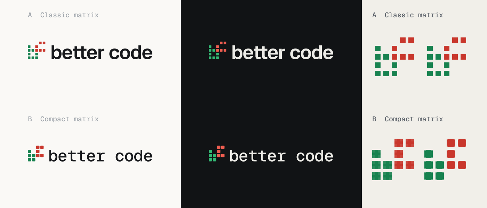

# Better Code design guidelines

This guide is for anyone who designs or writes anything with the Better Code name on it: the website, email signatures, invoices, slides, a CV, a conference badge.

**Status: adopted, 2026-11-26.** The website follows this guide. The logo is option B, the compact matrix (section 3). When the brand changes, change this guide in the same commit so the two never disagree.

How we write (voice, headings, words to avoid) has its own guide: [`docs/writing-guide.md`](../writing-guide.md).

The values in this guide are not copies. Colours and logo geometry live in [`src/brand.ts`](../../src/brand.ts); the website and the logo build script both read from there.

Contents:

1. [The brand in brief](#1-the-brand-in-brief)
2. [Voice and tone](#2-voice-and-tone)
3. [The logo](#3-the-logo)
4. [Colour](#4-colour)
5. [Typography](#5-typography)
6. [Layout and spacing](#6-layout-and-spacing)
7. [Components](#7-components)
8. [Imagery and the matrix motif](#8-imagery-and-the-matrix-motif)
9. [Motion](#9-motion)
10. [Accessibility](#10-accessibility)
11. [Privacy and performance](#11-privacy-and-performance)
12. [Writing about Crisp](#12-writing-about-crisp)
13. [Checklist before publishing](#13-checklist-before-publishing)
14. [Where the design lives in the code](#14-where-the-design-lives-in-the-code)

---

## 1. The brand in brief

**What Better Code is.** Better Code AB is Max Wenzin's own consulting company, founded in 2009 in Stockholm. Through it Max works as a hands-on software engineer, architect and team builder. Most client work runs through Crisp, where Max is a consultant and co-owner (section 12).

**The name is the promise:** code that is clear, tested and cheap to change, written by teams that enjoy working on it.

**Personality: engineer's craft.** The brand should feel like the work of a senior developer who cares about details: calm, precise, quietly technical. It should not feel like an agency, a startup or a hacker terminal.

| Value | In design | In writing |
|---|---|---|
| Craft | Exact grid, few elements, every detail placed on purpose | Concrete nouns and verbs; no buzzwords |
| Honesty | Real photo, real names, no stock imagery | Claims Max can back up; no superlatives |
| Calm | Plenty of whitespace, one accent at a time, no animation for show | Short sentences; no exclamation marks |
| Technical | Mono type for labels and data, the test matrix as the motif | Name the actual technologies, not "cutting-edge solutions" |

**In three words:** precise, calm, candid.

---

## 2. Voice and tone

The full guide is [How we write](../writing-guide.md). In short:

- **First person.** The site speaks as Max: "I build…", "my company".
- **Specific beats impressive.** "TypeScript, Java and Kotlin on AWS" beats "modern cloud-native technologies".
- **Headings are short phrases in sentence case, without a full stop.**
- **No hype words, no client names, nothing that goes stale.**
- **Humour, sparingly and dry.** The 404 page says "This test failed". That is about the limit.

---

## 3. The logo

### The idea

The symbol is a **test matrix**: a grid of square cells, like a test run's results. The green cells draw a lowercase **b** and the red cells draw a lowercase **c**: **b**etter **c**ode. The c sits one row higher than the b, so the mark rises from bottom left to top right, and the two letters share a corner, the way a passing and a failing test sit side by side in the same suite.

The original 2009 logo had the same idea as a small, pixelated PNG. These are vector redraws on an exact grid.

### Two options, B chosen

| | A. Classic matrix | B. Compact matrix |
|---|---|---|
| Grid | 5 × 5, the original layout cell for cell | 4 × 4, simplified |
| Cells | Square, thin gaps (cell 7, gap 3) | Fuller, slightly rounded (cell 8, gap 2, radius 1.6) |
| Wordmark | "better code" in Geist, weight 600 | "better code" in Geist Mono, weight 520 |
| Strength | Faithful to the original; the b and c read clearly at large sizes | Holds up at 16 px; the mono wordmark says *code* |
| Weakness | Thin cells get busy at favicon size | The b's bowl is solid, so the b reads less literally |

**B, the compact matrix, is the Better Code logo** (chosen 2026-11-26), set by `activeLogo` in `src/brand.ts`. Option A stays in `src/brand.ts` and `logo/` as a record of the original 2009 design; don't use it for new material.

### Construction

- The symbol is drawn on its own grid: one cell plus one gap is one **pitch**. Nothing is placed off the grid.
- In the lockup the wordmark's **baseline sits on the bottom edge of the symbol**, and its ascenders (b, t, d) reach the **top of the green b's stem**, so the two b's line up.
- The gap between symbol and wordmark is 0.28 × the symbol's height.
- The wordmark is always lowercase, always "better code" with a space. Never "BetterCode", "Better code" or "BC" in the logo.

### Clear space and minimum size

- Keep clear space around the lockup equal to **one pitch × 2** (two cells and two gaps) on every side.
- Minimum size: lockup 96 px wide on screen, 25 mm in print. Below that, use the symbol alone.
- The symbol alone works down to 16 px, but only in its favicon form: redrawn on a 16 px grid with whole-pixel cells (`faviconSvg` in `scripts/build-logo.mjs`).

### Colour versions

| File | Use |
|---|---|
| `<option>-lockup-light.svg` | Default: on paper or any light background |
| `<option>-lockup-dark.svg` | On dark backgrounds (uses the dark-mode palette) |
| `<option>-lockup-mono.svg` | One colour (`currentColor`): stamps, embroidery, single-colour print, fax-like situations |
| `<option>-symbol*.svg` | The symbol alone, same three versions |

All files are in [`logo/`](logo/). They contain outlines only (no fonts, no styles, no scripts), so they render the same everywhere.

### Don't

1. Don't change the cell pattern, swap the colours (green is always the b, red always the c), or add cells.
2. Don't put the colour logo on a green or red background, or on a busy photo. Use the mono version instead.
3. Don't stretch, rotate, outline, add shadows or gradients, or animate the cells individually.
4. Don't set the wordmark in another typeface or in capitals.
5. Don't use the red cells alone as a warning or error icon elsewhere in a design.

---

## 4. Colour

The palette is a refinement of the original pure green (#008000) and dark red (#AA0000): slightly deeper and more natural, tuned for contrast, on warm off-white paper and near-black ink. Dark mode is not an inversion. It has its own, brighter green and red so they keep their contrast on a dark background.

### Tokens

| Token | Role | Light | Dark |
|---|---|---|---|
| `paper` | Page background | `#faf9f6` | `#111315` |
| `surface` | Cards, code blocks, notes | `#f1efe9` | `#1a1d20` |
| `ink` | Text, primary button | `#17191c` | `#ecebe6` |
| `muted` | Secondary text, labels | `#5a6068` | `#a1a7ad` |
| `rule` | Borders and dividers | `#dedad1` | `#2d3135` |
| `green` | Logo b, focus ring, markers, hover fills | `#17824f` | `#33b873` |
| `green-text` | Links and green text | `#11673e` | `#5fd394` |
| `red` | Logo c, the 404 marker | `#c9372c` | `#ef5d50` |
| `red-text` | Red text, used rarely | `#a52a21` | `#ff8a7e` |

### Contrast against paper (WCAG)

| | Light | Dark |
|---|---|---|
| ink | 16.7:1 | 15.6:1 |
| muted | 6.0:1 | 7.7:1 |
| green-text | 6.6:1 | 10.0:1 |
| red-text | 6.8:1 | 8.1:1 |
| green (graphics) | 4.6:1 | 7.3:1 |
| red (graphics) | 4.9:1 | 5.6:1 |

`test/palette.test.mjs` fails the build if any text colour drops below 4.5:1 on paper or surface, or a logo colour below 3:1.

### Rules

- **Green is the accent; red is rare.** On any one screen, green appears in small doses (links, markers, one hover) and red almost never outside the logo.
- **Never use red and green as the only way to tell things apart** (about 1 in 12 men have red–green colour vision deficiency). The logo is fine, because its letters have different shapes; data and UI states must also differ by shape, text or position.
- **No other accent colours.** Need a third colour for a chart? Use ink and muted tints first.
- **No gradients, no shadows** except a 1 px `rule` border.
- **Dark mode follows the visitor's system setting.** There is no toggle.

---

## 5. Typography

Two families from the same designer, so they sit well together. Both are open source (SIL Open Font License) and self-hosted.

| Family | Use |
|---|---|
| **Geist** (variable, 100–900) | Headings, body text, buttons |
| **Geist Mono** (variable, 100–900) | Labels ("eyebrows"), dates, the organisation number, the email address, code, the compact wordmark |

### Scale

Fluid sizes that grow with the viewport between a phone and a wide screen:

| Token | Phone → wide | Use |
|---|---|---|
| `--step--1` | 13.4 → 14.4 px | Labels, footer, captions |
| `--step-0` | 16 → 18 px | Body text |
| `--step-1` | 19 → 23 px | Lead paragraphs, h3 |
| `--step-2` | 23 → 30 px | Article h2, the email address |
| `--step-3` | 29 → 44 px | Section headings (h2) |
| `--step-4` | 37 → 68 px | The page's one h1 |

### Rules

- **Weights:** body 400, buttons 550, headings 620, wordmark 600 (Geist) or 520 (Geist Mono). Don't use the extremes (100–300, 800–900).
- **Headings:** tight leading (1.12) and slightly negative tracking (−0.025 em; −0.035 em for h1). Balanced line breaks.
- **Body:** line height 1.6, measure at most 40 rem (about 70 characters).
- **Mono is for things you would copy or scan:** dates, numbers, identifiers, handles, addresses, code. Not for paragraphs.
- **Sentence case everywhere.** No all-caps text, except acronyms.
- Only the Latin subset is shipped (the site is in English).

---

## 6. Layout and spacing

- **One column of reading, one wide wrapper.** Content is at most 70 rem wide, with a fluid side gutter (16 px on phones up to 40 px). Running text stays within the 40 rem measure.
- **Spacing steps** on a 4 px base: 4, 8, 12, 16, 24, 32, 48, 72 and 112 px (`--space-1` to `--space-9`). Use only these.
- **Sections** are separated by a 1 px `rule` line and 72 px of space above and below.
- **Two-column splits** (text + portrait, text + logo) are 1.6 : 1 from 56 rem up, and stack on smaller screens with the text first.
- **Corners:** 6 px radius on cards, buttons, images and code blocks. Nothing is fully rounded (no pills, no circles), because the brand is built from squares.
- **Alignment:** everything starts on the left edge of the wrapper. Centre text only in captions under a centred graphic.

---

## 7. Components

| Component | Spec |
|---|---|
| **Eyebrow** | Mono, `--step--1`, muted, with one green cell (0.6 em square, 1.5 px radius) before it. Goes above every section heading. Red cell only on error pages. |
| **Primary button** | Ink fill, paper text, 6 px radius. On hover: green fill. One per view. |
| **Quiet button** | Transparent, rule border, ink text. On hover: ink border. |
| **Link** | `green-text`, 1 px underline offset 0.18 em; 2 px underline on hover. |
| **Card** | Surface background, 1 px rule border, 24 px padding, 6 px radius. Starts with a mono green index (01, 02…) when cards form a sequence. |
| **Profile link** | Rule-bordered box: the service's mark, then its name (bold) over the handle (mono, muted). Green border on hover. |
| **Test run** | The logo symbol enlarged in a surface box. When it scrolls into view, its cells start pending (`rule` grey) and resolve one by one into green and red, then the caption reads "10 tests, 5 passed, 5 failed". "Run again" replays it. (`src/components/TestRun.astro`) |
| **Note** | Surface background, 3 px rule border on the left, muted `--step--1` text. Used for the "archived article" notice. |
| **Code block** | Surface background, rule border, mono at 0.9 em. No syntax colours (they would add a palette of their own and need inline styles). |
| **Focus ring** | 2 px green outline, 3 px offset, on every interactive element. Never remove it. |

**Icons** are used only on the profile links: monochrome marks for LinkedIn, GitHub and Crisp in `muted`, turning `ink` on hover (`src/components/ProfileIcon.astro`). They always sit next to the name in text, never alone. The GitHub mark comes from Simple Icons (CC0); the LinkedIn mark is a plain "in" tile, as LinkedIn's brand guidelines allow for linking to a profile; the Crisp wordmark is Crisp's own. No other icons: link text says where a link goes.

---

## 8. Imagery and the matrix motif

- **Portrait:** one real photo of Max, square, light and plain background, shown at most 22 rem wide with the 6 px radius and a 1 px `rule` border (so its light background has an edge on paper). No filters or duotones. Replace it when it no longer looks like him.
- **No stock photos, no illustrations of people, no AI-generated imagery.**
- **The matrix is the only graphic motif.** It appears as the symbol in the header, enlarged in the company section, as single cells (eyebrow markers), and as the green/red bar on the social image. Use it whole or as single cells; don't invent new letter shapes from it.
- **Social image** (`public/og.png`, 1200 × 630): paper background, the lockup, one line of tagline in muted Geist, the domain in green Geist Mono, and a green/red bar along the bottom edge. The tagline is a plain description ("Software engineer and architect in Stockholm"), not a slogan.

---

## 9. Motion

Almost none, and never for its own sake.

- Colour and border transitions of 150 ms on hover.
- Smooth scrolling to in-page anchors.
- **One piece of play:** the test run in the company section (section 7). It runs once, when it comes into view, and takes under three seconds. Cells shrink a little and settle as they resolve, like results coming in from parallel tests.
- **Reduced motion is respected everywhere.** When the visitor's system asks for it, there is no smooth scrolling and the test run shows the finished logo without animating. The same happens without JavaScript.

---

## 10. Accessibility

Target: **WCAG 2.2 AA**.

- Contrast is enforced by test (section 4).
- Every page has one h1, a logical heading order, a "Skip to content" link and landmarks (header, nav, main, footer).
- The focus ring is always visible.
- The logo symbol is decorative (`aria-hidden`); the header link is labelled "Better Code, home".
- Images have alt text; decorative graphics have none.
- Text can be zoomed to 200 % without horizontal scrolling at 320 px width.
- Colour is never the only carrier of meaning (section 4).

---

## 11. Privacy and performance

The site is a calling card. It should load instantly and track no one.

- **No cookies, no analytics, no third-party requests.** Fonts and images are served from the site itself.
- **A strict Content Security Policy** (`public/_headers`): no inline scripts or styles. The only exception is the embedded Mindmeister map in one 2012 article.
- **JavaScript is optional.** The one script turns the email address into a `mailto:` link; without it the address still reads "max.wenzin at bettercode.se".
- **The email address never appears whole in the HTML**, to slow down address-harvesting bots.
- **Images** are converted to WebP at build time and sized for their slot.

---

## 12. Writing about Crisp

Better Code and Crisp are separate companies. Get the relationship right:

- **Crisp AB** is a consulting company in Stockholm with **no employees and no managers**. It calls itself "a home for IT consultants". Every consultant runs their own company and invoices through Crisp. ([Crisp DNA](https://dna.crisp.se/docs/index.html) describes the model.)
- **Max is a consultant at Crisp since 2011 and one of its co-owners.** Say "consultant at, and co-owner of, Crisp" or "I work with clients through Crisp".
- **Don't** call Crisp an employer, an agency or "just a network", and don't call Max a Crisp employee.
- **Crisp is clear but secondary on this site.** It gets its own section and a link to Max's Crisp profile; the main call to action is still to contact Max directly.
- Don't use Crisp's logo on Better Code material; link to crisp.se by name.

---

## 13. Checklist before publishing

- [ ] Logo: right file for the background (light, dark or mono), with clear space, not below minimum size.
- [ ] Colour: only palette tokens; green as accent, red only in the logo; nothing relies on red vs green alone.
- [ ] Type: Geist and Geist Mono only; sentence case; mono only for data, labels and code.
- [ ] Spacing: only the spacing steps; 6 px corners.
- [ ] Copy: follows [How we write](../writing-guide.md); Crisp described correctly.
- [ ] Accessibility: headings in order, alt text, focus visible, `npm test` passes.
- [ ] Privacy: no third-party requests, no new inline scripts or styles.

---

## 14. Where the design lives in the code

| What | Where |
|---|---|
| Palette, logo geometry, logo options, active logo | [`src/brand.ts`](../../src/brand.ts) |
| Colour tokens as CSS (generated from `brand.ts`) | `src/pages/tokens.css.ts` → `/tokens.css` |
| Writing rules | [`docs/writing-guide.md`](../writing-guide.md) |
| Fonts, type scale, spacing, base elements, buttons, eyebrow | [`src/styles/global.css`](../../src/styles/global.css) |
| Logo on the website (symbol as inline SVG, wordmark as live text) | `src/components/Symbol.astro`, `src/components/Logo.astro` |
| Logo SVG files, favicons, home-screen icons, social image, the sheet above | built by `npm run logo` (`scripts/build-logo.mjs`) |
| Contrast tests | `test/palette.test.mjs` |

To change a colour: edit `src/brand.ts`, run `npm run logo` (the icons and social image embed colours), then `npm run verify`.
